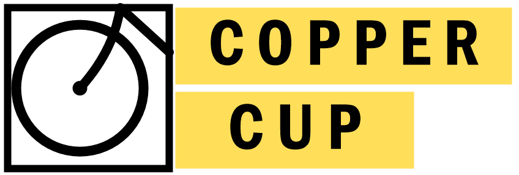

# COPPER CUP — Your Bike Café

<p align="center">
  
</p>

<p align="center">
  <strong>Artisanal Coffee &bull; Homemade Food &bull; Precision Bicycle Repairs &bull; Community Workshops</strong>
</p>

<p align="center">
  
  
  
  
  
</p>

---

## ☕ About Copper Cup

**Copper Cup** is a modern hybrid cycling café concept that blends specialty espresso culture with a full-service bicycle workshop and community hub. Cyclists, commuters, and coffee enthusiasts can unwind with freshly roasted single-origin coffees, homemade culinary specialties, or cold craft beers while their bicycles receive professional tune-ups, tire replacements, or drivetrain overhauls.

For riders who love getting their hands dirty, Copper Cup also hosts weekly hands-on repair workshops, group road/gravel rides, and seasonal cycling events.

---

## ✨ Features

- **Iconic Visual Branding**: Distinctive **Copper Cup** identity utilizing the custom bicycle-wheel emblem, industrial-warm color palette (`#FFDE59` accent yellow, `#62372D` espresso brown, `#000` deep black), and modern typography (*Bebas Neue* & *Aleo*).
- **Responsive Sticky Navigation**: Clean desktop navigation links with an interactive hamburger drawer menu on tablet and mobile viewports.
- **Hero Showcase**: High-impact split-screen presentation highlighting the dual identity of bike repairs and artisan café offerings.
- **Interactive Specialties Gallery**:
  - Horizontal drag & wheel-scrollable card carousel displaying menu items (burgers, artisan tortes, matcha, espresso beverages, waffles, stone-oven pizza).
  - Smooth previous/next arrow button controls.
- **Comprehensive Repairs & Contact Section**:
  - Direct appointment booking with **Primary & Alternative** phone lines.
  - Dedicated **Emergency Bike Dispatch** hotline.
  - Primary inquiries and service desk email routing.
  - Interactive Google Maps location embed.
  - Multi-location display featuring the Main Clubhouse & Workshop alongside the Alternative Express Drop-off Hub.
  - Clear weekly operating schedules for weekdays, Saturdays, and Sundays.
- **Micro-Animations & Viewport Triggers**: Performance-friendly `IntersectionObserver` revealing content sections as users scroll.
- **Interactive Footer**:
  - Quick-subscribe newsletter bar.
  - Direct clickable contact links (`tel:` and `mailto:`).
  - Social media community links (Facebook, Instagram, TikTok).

---

## 📞 Contact & Alternative Support Details

Copper Cup offers multiple communication channels to ensure rapid assistance for both café visitors and cyclists on the road:

| Channel | Contact Detail | Purpose / Note |
| :--- | :--- | :--- |
| **Primary Telephone** | [`+1 (555) 234-2877`](tel:+15552342877) | Workshop appointments & table bookings |
| **Alternative Telephone / WhatsApp** | [`+1 (555) 234-2878`](tel:+15552342878) | *Alt Concierge*, quick messaging & order pickup updates |
| **Emergency Rapid Dispatch** | [`+1 (555) 234-BIKE`](tel:+15552342453) | Roadside breakdown & flat-tire assistance |
| **Primary Email** | [`hello@coppercup.com`](mailto:hello@coppercup.com) | General questions, event bookings & partnerships |
| **Alternative Service Email** | [`repairs@coppercup.com`](mailto:repairs@coppercup.com) | *Alt Desk* — Mechanic inquiries & custom builds |

### 📍 Locations

- **Main Clubhouse & Workshop**:  
  `1420 Copper Creek Blvd, Suite 100, Seattle, WA 98101`  
  *(Full café menu, espresso bar, complete bicycle service pit, and workshop classroom)*
- **Alternative Express Hub & Drop-Off**:  
  `852 Velodrome Way, Bike District, Seattle, WA 98109`  
  *(Quick tune-up drop-offs, commuter tire fills, and grab-and-go cold brew)*

### 🕒 Operating Hours

- **Monday &ndash; Friday**: 7:00 AM &ndash; 8:00 PM
- **Saturday**: 8:00 AM &ndash; 7:00 PM
- **Sunday**: 8:00 AM &ndash; 5:00 PM *(Community group ride starts at 8:30 AM)*

---

## 📁 Project Structure

```text
Copper-Cup/
├── index.html                   # Main landing page markup
├── app.js                       # Interactive logic (menu, gallery, observer)
├── README.md                    # Project documentation
├── images/
│   ├── logo.png                 # Copper Cup brand logo (Bebas/Franklin style)
│   ├── favicon.png              # Website favicon
│   ├── backbtn.png              # Gallery previous navigation button
│   ├── forwardbtn.png           # Gallery next navigation button
│   ├── clifford-VobvKmG-StA-unsplash.jpg # Hero image
│   ├── mechanic-repairing-bicycle.jpg     # Workshop background
│   └── gallery/                 # Specialty food & beverage photography
│       ├── burger.jpg
│       ├── cappu.jpg
│       ├── matcha.jpg
│       ├── pizza.jpg
│       ├── sandy.jpg
│       ├── spaghetti.jpg
│       ├── torte.jpg
│       └── waffel.jpg
└── styles/
    ├── _variables.scss          # Color palette & typography definitions
    ├── _media-queries.scss      # Responsive breakpoints (tablet, mobile)
    ├── _navbar.scss             # Header, logo, and drawer menu styles
    ├── styles.scss              # Master SCSS source file
    └── styles.css               # Compiled production stylesheet
```

---

## 🛠️ Tech Stack & Design System

- **HTML5**: Semantic document layout with accessible landmark elements (`<nav>`, `<section>`, `<footer>`, `<address>`).
- **SCSS / CSS3**:
  - Flexbox and CSS Grid layout structures.
  - CSS Custom variables for consistent brand colors:
    - `$yellow`: `#FFDE59`
    - `$coffee`: `#62372D`
    - `$beige`: `#E9D8C4`
    - `$black`: `#000000`
    - `$white`: `#FFFFFF`
  - Responsive media queries targeting desktop, tablet (`<= 768px`), and mobile screens (`<= 280px`).
- **JavaScript (Vanilla ES6+)**:
  - `IntersectionObserver` API for smooth reveal-on-scroll animations.
  - Horizontal mousewheel and touch scroll listener for the gallery.
  - Dynamic mobile drawer toggling with automatic close on anchor selection.
- **Font & Icon Assets**:
  - Google Fonts: **Bebas Neue** (display headings) and **Aleo** (serif body text).
  - Font Awesome 6: Crisp vector icons for contact channels, social media, and navigation.

---

## 🚀 Getting Started

No build step or external dependencies are required to run Copper Cup locally:

1. **Clone or Download** the repository:
   ```bash
   git clone https://github.com/mdohr07/coffeestop.git
   cd Copper-Cup
   ```

2. **Open `index.html`** in any modern web browser:
   - Double-click `index.html`, or
   - Use VS Code Live Server extension: right-click `index.html` &rarr; *Open with Live Server*, or
   - Serve with a quick local static server:
     ```bash
     npx serve .
     ```

3. **SCSS Compilation (Optional)**:
   If you wish to edit SCSS source files:
   ```bash
   npx sass styles/styles.scss:styles/styles.css --watch
   ```

---

## 💡 Code Highlights

### Smooth Scroll Gallery & Wheel Navigation (`app.js`)
```javascript
const scrollContainer = document.querySelector(".specialities__gallery");
const prevBtn = document.getElementById("prevBtn");
const nextBtn = document.getElementById("nextBtn");

scrollContainer.addEventListener("wheel", (evt) => {
    evt.preventDefault();
    scrollContainer.scrollLeft += evt.deltaY;
    scrollContainer.style.scrollBehavior = "auto";
});

nextBtn.addEventListener("click", () => {
    scrollContainer.style.scrollBehavior = "smooth";
    scrollContainer.scrollLeft += 1000;
});

prevBtn.addEventListener("click", () => {
    scrollContainer.style.scrollBehavior = "smooth";
    scrollContainer.scrollLeft -= 1000;
});
```

### Viewport Intersection Observer (`app.js`)
```javascript
const observer = new IntersectionObserver((entries) => {
    entries.forEach((entry) => {
        if (entry.isIntersecting) {
            entry.target.classList.add('show');
        } else {
            entry.target.classList.remove('show');
        }
    });
});

const hiddenElements = document.querySelectorAll('.hidden');
hiddenElements.forEach((el) => observer.observe(el));
```

---

## 📄 License & Credits

- Developed for **Copper Cup | Your Bike Café**.
- Photography courtesy of [Unsplash](https://unsplash.com).
- Icons provided by [Font Awesome](https://fontawesome.com).
